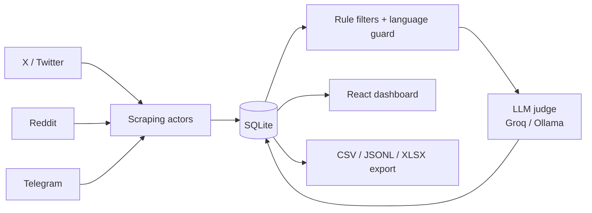

# LeadSweep

**Self-hosted lead discovery for social platforms.** LeadSweep watches X (Twitter), Reddit and Telegram for people publicly asking for what you sell — "looking for an agency", "anyone recommend a…", "hiring a contractor" — and qualifies each post with rules plus an LLM judge that must quote the exact words that make it a lead.

It runs on your own machine: a FastAPI backend, a React dashboard, and a local SQLite database. No hosted service, no telemetry.

> **Intended use:** a personal/internal tool for your own prospecting. It is not hardened for exposure to the public internet — keep it bound to `localhost` or behind your own VPN/auth proxy. See [SECURITY.md](SECURITY.md).

---

## Features

- **X / Twitter** — keyword search, profile timelines, replies and followers, driven by a real browser (Playwright) using *your own* logged-in session.
- **Reddit** — subreddit and intent search with **no credentials** (via the public Arctic Shift archive), or offline from JSON exports.
- **Telegram** — public channels and topic search with no account; optional Telethon (MTProto) access.
- **LLM qualification** — Groq (free tier works), local Ollama, or rules-only. Every lead carries a verbatim evidence quote and a role (`requester`, `recruiter`, `seller`, `aggregator`, …), so sellers and job boards don't pollute your list.
- **Dashboard** — create scrapers, watch jobs, triage leads, export CSV / JSONL / XLSX.
- **CLI + MCP server** — script everything, or plug LeadSweep into an MCP-capable agent.

## How it works



---

## Quickstart (local, ~5 minutes)

**Prerequisites:** Python 3.11+, Node.js 20+, git.

```bash
git clone https://github.com/ammarhaiderak/leadsweep.git && cd leadsweep

# 1. Python backend
python -m venv .venv
source .venv/bin/activate            # Windows: .venv\Scripts\activate
pip install -r requirements.txt
playwright install chromium          # only needed for X scraping

# 2. Configure
cp .env.example .env
#   Edit .env and set at least:
#     LEADSWEEP_ADMIN_EMAIL / LEADSWEEP_ADMIN_PASSWORD   (your login)
#     LEADSWEEP_GROQ_API_KEY                             (optional, free at console.groq.com)

# 3. Build the dashboard
cd project && npm ci && npm run build && cd ..

# 4. Run
LEADSWEEP_WEB_DIST=project/dist uvicorn leadsweep.api:app --host 127.0.0.1 --port 8000
```

Open <http://127.0.0.1:8000> and sign in with the email and password from your `.env`. The owner account is created on first sign-in.

**Shortcut:** `./run.sh` on macOS/Linux (stop with `./stop.sh`), or double-click **`RUN.bat`** on Windows (stop with `STOP.bat`). Both create the virtualenv, install dependencies and Chromium, and start the app — you still edit `.env` yourself. `run.sh` serves the built dashboard at <http://127.0.0.1:8000>; `RUN.bat` runs the dev dashboard at <http://localhost:5173>.

> **Linux servers without a display:** `capture_session` needs a visible browser. On a headless box, paste your `auth_token` / `ct0` cookies into `sessions.json` instead (see below). If Chromium fails to start, install its system libraries with `sudo .venv/bin/python -m playwright install-deps chromium`.

### Frontend development

Run the API on port 8000 as above, then in another terminal:

```bash
cd project && npm run dev     # http://localhost:5173, proxies /v1 and /api to :8000
```

### Docker

```bash
cp .env.example .env              # fill in as above
mkdir -p secrets && cp sessions.example.json secrets/sessions.json   # see "Connecting X"
docker compose up -d --build
curl -s http://127.0.0.1:8000/health
```

To run the pipeline on a schedule instead of the dashboard: `docker compose run -d studio loop` (every `RUN_INTERVAL_S` seconds, default 4h), or `docker compose run --rm studio run-once`.

The container binds to `127.0.0.1` by default. Data lives in `./data`.

---

## Connecting the platforms

| Platform | What you need |
|---|---|
| **Reddit** | Nothing. Works out of the box via the public archive. |
| **Telegram** | Nothing for public channels. For MTProto, set `LEADSWEEP_TELEGRAM_API_ID` / `_API_HASH` from <https://my.telegram.org>. |
| **X / Twitter** | Your own session cookies. Either run `python -m scripts.capture_session --id acct-1` (opens a browser, you log in), or copy `sessions.example.json` to `sessions.json` and paste the `auth_token` and `ct0` cookies from a logged-in browser. You can also connect an account from the dashboard. |

**Use a secondary X account.** Automated browsing is against X's terms of service and accounts can be rate-limited or suspended. LeadSweep paces itself conservatively, but you are responsible for how you use it.

## Configuration

All configuration is via environment variables (or `.env`), prefixed with `LEADSWEEP_`. [`.env.example`](.env.example) documents every option; blank values fall back to defaults. The ones you'll most likely touch:

| Variable | Purpose |
|---|---|
| `LEADSWEEP_ADMIN_EMAIL`, `LEADSWEEP_ADMIN_PASSWORD` | Your dashboard login. |
| `LEADSWEEP_API_KEY` | Shared secret for `/api/*` routes, scripts and integrations (`X-API-Key` header). |
| `LEADSWEEP_LLM_PROVIDER` | `auto` (default), `groq`, `ollama` or `heuristic`. |
| `LEADSWEEP_GROQ_API_KEY` | Enables Groq LLM qualification. |
| `LEADSWEEP_GROQ_MODEL` | Groq model (default `openai/gpt-oss-120b`; fallback `openai/gpt-oss-20b`). |
| `LEADSWEEP_LLM_TOP_N` | Max candidates per job sent to the LLM (default 150) — lower it on free-tier keys. |
| `LEADSWEEP_BLOCK_MEDIA` | Skip images/video while scraping X (default `true`, saves bandwidth and RAM). |
| `LEADSWEEP_DB_PATH` | SQLite file (default `data/leadsweep.db`). |
| `LEADSWEEP_WEB_DIST` | Serve the built dashboard from the API. |

Search queries and scoring thresholds for scheduled pipeline runs live in [`config/queries.toml`](config/queries.toml).

## Command line

```bash
pip install -e .           # installs the `leadsweep` command
leadsweep --help
leadsweep leads --help     # triage leads / record feedback from the terminal
leadsweep datasets --help  # export / search datasets
python -m scripts.doctor   # diagnose your setup
python -m scripts.run_pipeline   # one scheduled pipeline run (see config/systemd/ for a timer)
```

Useful scripts in `scripts/`: `doctor`, `status`, `show_leads`, `create_owner` (reset the owner password), `backup_db`, `capture_session`, `check_session`, `reevaluate`, `secret_scan`.

## Running tests

```bash
pip install -r requirements-dev.txt
pytest -m "not live" -q
```

Tests are hermetic — no network, browser, or API keys needed. Tests marked `live` hit real services and are skipped by default.

---

## Known limitations

- **Single-user by design.** The owner can add teammates from the **Users** page, but per-user data isolation is not enforced server-side. Treat every account as trusted.
- **X depends on your session.** Expect daily limits of roughly a few hundred requests per account; cookies expire and need re-capturing.
- **Reddit live data comes from an archive** (Arctic Shift), so very recent posts may lag. Reddit's own JSON API returns 403 without approved OAuth.
- **Telegram:** public channels only; private groups are not supported.
- **Groq free tier** has daily/minute token caps; LeadSweep paces requests and can fall back to a second model.

## Troubleshooting

- **Can't sign in** — check `LEADSWEEP_ADMIN_EMAIL` / `LEADSWEEP_ADMIN_PASSWORD` in `.env` and restart the server. Reset with `python -m scripts.create_owner`.
- **`/api/*` returns 503** — set `LEADSWEEP_API_KEY`.
- **X search returns nothing / `SESSION_COOLDOWN`** — cookies expired or rate-limited; re-run `capture_session` or wait.
- **Groq 429 errors** — lower `LEADSWEEP_LLM_TOP_N` and set `LEADSWEEP_GROQ_FALLBACK_MODEL`.
- **Windows `ZoneInfoNotFoundError`** — `pip install tzdata`.
- **Windows Playwright `NotImplementedError`** — start with plain `uvicorn leadsweep.api:app` (no `--loop uvloop`).

## Project layout

```
leadsweep/          Python backend
  actors/           X scraping actors (search, timelines, replies, followers…)
  integrations/     Reddit integration
  pipeline/         Ingestion pipeline, qualification graph, SQLite store
  leadintel/        Query generation, retrieval heuristics, LLM judge
  services/         Agent, scheduler, enrichment, email, Telegram
  api.py            FastAPI app       cli.py   CLI       mcp_server.py   MCP server
project/            React + Vite dashboard
config/             queries.toml, example systemd units
scripts/            Operational utilities (doctor, backups, session capture…)
tests/              Hermetic test suite
```

## Contributing

Contributions are welcome — see [CONTRIBUTING.md](CONTRIBUTING.md).

## Responsible use

LeadSweep only reads publicly available content, but scraping may still violate a platform's terms of service and local law (e.g. GDPR when storing personal data). Respect rate limits, don't spam the people you find, and delete data you no longer need.

## License

[MIT](LICENSE)
